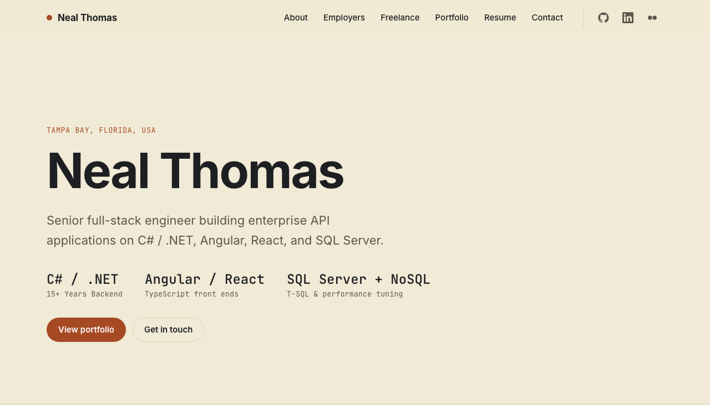
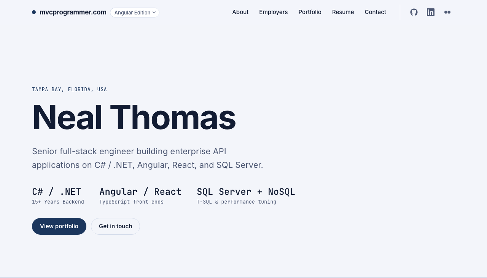
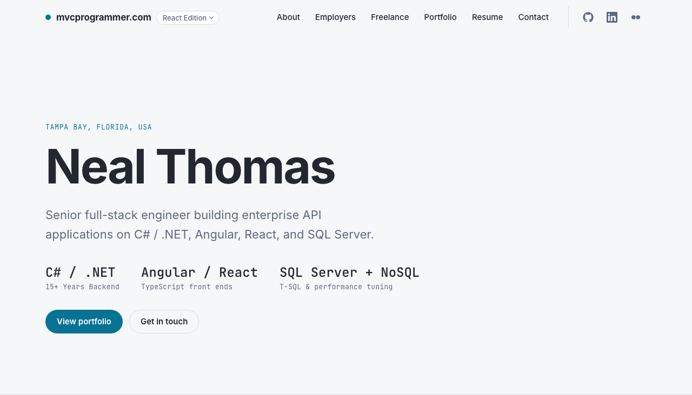
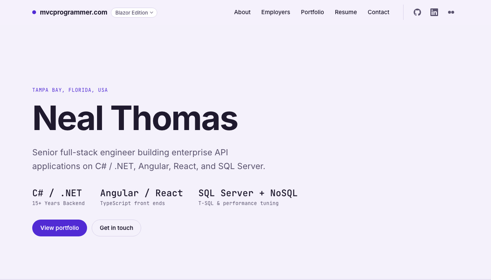
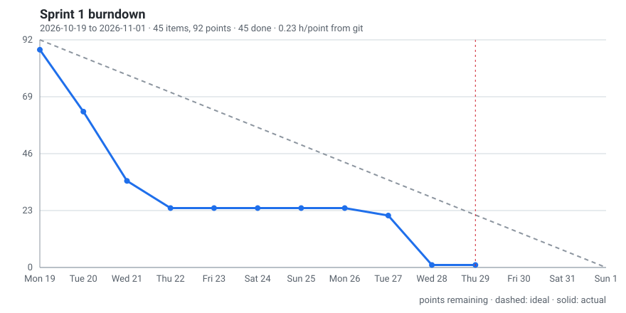

<div align="center">

# mvcprogrammer.com

**The source for [mvcprogrammer.com](https://mvcprogrammer.com), the portfolio site of [Neal Thomas](https://github.com/mvcprogrammer).**

[](https://mvcprogrammer.com)
&nbsp;[](https://github.com/mvcprogrammer/mvcprogrammer.com/actions/workflows/deploy.yml)

<br>

<picture>
  <source media="(prefers-color-scheme: dark)" srcset="https://raw.githubusercontent.com/mvcprogrammer/mvcprogrammer.com/main/docs/images/mvcprogrammer-com-dark.png">
  
</picture>

</div>

<br>

The site follows the **KISS principle**: keep it simple, and add nothing that is not earning its place. It is plain HTML, CSS, and vanilla JavaScript with no framework, no build step, no bundler, no third-party scripts, and a strict Content Security Policy. One page, one stylesheet plus a short palette override, one deferred script, shipped exactly as written. The static files sit in a private S3 bucket behind CloudFront, and three small Lambda functions do the only work that needs a server: the contact form, the resume download, and the Experience API. The same page is also built three more times, with Angular, with React, and with Blazor WebAssembly, as a side-by-side comparison; see [Four editions](#four-editions).

## What is in this repository

| Path | What it is |
| --- | --- |
| `index.html`, `styles.css`, `vanilla.css`, `main.js` | The site. `styles.css` is shared by all four editions; `vanilla.css` overrides its design tokens with the eggshell palette for this edition. The Experience timeline is in the HTML so it reads without JavaScript; when the API answers, the script re-renders it from JSON and reveals a skill filter. |
| `404.html`, `privacy.html`, `terms.html` | The not-found page and the policies required for the toll-free SMS registration. |
| `assets/` | Self-hosted fonts (Inter and JetBrains Mono as variable WOFF2 subsets) and images. Icons are an inline SVG sprite in the HTML. |
| `angular/` | The Angular edition: an Angular 22 workspace with Vitest tests. See [angular/README.md](angular/README.md) and [docs/ANGULAR-EDITION.pdf](docs/ANGULAR-EDITION.pdf). |
| `react/` | The React edition: a React 19 app built with Vite, with Vitest and Testing Library tests. See [react/README.md](react/README.md) and [docs/REACT-EDITION.pdf](docs/REACT-EDITION.pdf). |
| `blazor/` | The Blazor edition: a Blazor WebAssembly app on .NET 10 with bUnit tests. See [blazor/README.md](blazor/README.md) and [docs/BLAZOR-EDITION.pdf](docs/BLAZOR-EDITION.pdf). |
| `api/` | The Experience API: C# on .NET 10, run on AWS Lambda (arm64) and reading a single DynamoDB table. Spec-first with OpenAPI 3.1, tested over the in-process host, deployed with SAM. See [api/README.md](api/README.md). |
| `infra/` | The contact-form and resume-download Lambdas (Node.js 22 on arm64), the CloudFront Function that redirects `www` and answers the engagement beacon, and the SES DKIM change batch. |
| `tools/` | `cf-stats.mjs`, which reads the CloudFront access logs and prints visits, unique visitors, referrers, and what the beacon recorded; `stats-export.mjs`, which writes the same figures as day files for the visitor dashboard; `stats-report.mjs`, which renders an export run's account as the job summary on its Actions page; the shared parser in `lib/` and its tests; `serve.mjs`, a local preview that forwards `/api/*` to the functions; `board-backfill.mjs` and `burndown.mjs`, which fill the project board's dates and hours from git and draw the sprint burndown. See [Visitor stats](docs/DEPLOY.md#visitor-stats) and [docs/BURNDOWN.md](docs/BURNDOWN.md). |
| `stats/` | The private visitor dashboard (React 19 + Vite + Chart.js) that reads the day files `tools/stats-export.mjs` writes. See [stats/README.md](stats/README.md) and [docs/STATS-DASHBOARD.pdf](docs/STATS-DASHBOARD.pdf). |
| `docs/` | [DEPLOY.md](docs/DEPLOY.md), the infrastructure walkthrough; [BURNDOWN.md](docs/BURNDOWN.md), how the board's dates, hours, and burndown are derived; the three edition guidelines and the dashboard guideline; and the screenshots above. |
| `.github/workflows/` | `ci.yml` runs every test suite on each pull request and is the check `main` requires before a merge; `deploy.yml` is the deploy, which runs that same workflow first and ships nothing if a suite fails, GitHub Actions authenticated with OIDC, so no AWS keys are stored anywhere; `stats.yml` is the scheduled visitor-stats export. |

Every npm workspace (`angular/`, `react/`, `stats/`, and `infra/lambda/stats-auth/`) carries a `.npmrc` that pins `legacy-peer-deps=false`. A project-level file wins over a developer's `~/.npmrc`, so a lockfile refreshed on any machine resolves the same tree the GitHub Actions runner computes with npm's defaults, and `npm ci` there accepts it. A new workspace gets the same file.

## How it is served

- **Hosting.** A private S3 bucket that only CloudFront can read, through Origin Access Control. CloudFront serves over HTTP/2 and HTTP/3 with an ACM certificate, Route 53 aliases the domain, and a CloudFront Function redirects `www` to the apex.
- **Security.** A response headers policy sets a same-origin Content Security Policy, two-year HSTS, `X-Frame-Options: DENY`, `nosniff`, and a locked-down Permissions-Policy. No cookies and no third-party analytics: the only measurement is a first-party beacon (`GET /ping`) that the CloudFront edge answers with 204 and that leaves nothing but a line in the access logs, which `tools/cf-stats.mjs` reads. It reports the page load (screen class and color scheme), the sections reached, clicks on the edition and profile links, and the seconds the page was visible; it carries no identifier and stays silent only on local previews.
- **Experience API.** `/api/experience` and `/api/skills` on the same domain. Responses carry ETags and cache headers so CloudFront answers most requests itself, errors follow RFC 9457 problem details, and the function URL accepts only requests signed by CloudFront. The contract is [api/openapi.yaml](api/openapi.yaml).
- **Deploys.** Every push to `main` assumes a least-privilege IAM role through OIDC, syncs the bucket in two passes (a week of browser caching for fonts and images, five minutes for pages), and invalidates the CloudFront cache. Third-party actions are pinned to commit hashes.

## Four editions

The same page is built four ways from this repository. Every edition shows the same content, loads the same stylesheet, and reads the same Experience API; what differs is how the page reaches the browser.

| Edition | Built with | Source | Live |
| --- | --- | --- | --- |
| Default | HTML, CSS, and vanilla JavaScript. No framework, no build step. | repository root | [mvcprogrammer.com](https://mvcprogrammer.com) |
| Angular | Angular 22: standalone components, signals, and a reactive form in TypeScript. | [`angular/`](angular/) | [angular.mvcprogrammer.com](https://angular.mvcprogrammer.com) |
| React | React 19 with Vite: function components, hooks, and React Router in TypeScript. | [`react/`](react/) | [react.mvcprogrammer.com](https://react.mvcprogrammer.com) |
| Blazor | Blazor WebAssembly on .NET 10: Razor components and C# running in the browser. | [`blazor/`](blazor/) | [blazor.mvcprogrammer.com](https://blazor.mvcprogrammer.com) |

Each framework edition has its own test suite, README, and guideline PDF, its own CloudFront distribution and certificate under the same bucket, and its own job in the deploy workflow. The editions mirror each other: a change to one is made to the others in the same commit, and the stylesheet, fonts, images, icons, and seed data are shared from the root rather than copied by hand. The edition menu in the header and the skill chips in the About section link between the editions, so each one is a click away from the others.

### Palettes

Color is the one deliberate difference between the editions. Each layers a small palette file over the shared stylesheet that overrides only the design tokens (`--bg`, `--accent`, `--hover`, and the rest) with `light-dark()` values, so one declaration covers both color schemes and no rule from `styles.css` is repeated. Older browsers ignore `light-dark()` and fall back to the shared JetBrains Rider palette.

| Edition | Palette file | Palette | Light | Dark |
| --- | --- | --- | --- | --- |
| Default | [`vanilla.css`](vanilla.css) | Eggshell paper with a terracotta accent and a coral hover; a warm charcoal after dark. |    |    |
| Angular | [`angular/src/angular.css`](angular/src/angular.css) | Navy and brass: a cool, faintly blue page with navy buttons and a goldenrod hover; a true navy after dark with muted brass for buttons and links and a paler gold on hover. |    |    |
| React | [`react/src/react.css`](react/src/react.css) | The react.dev documentation palette: cool slate surfaces, React blue for buttons and links, the logo cyan on hover. |    |    |
| Blazor | [`blazor/…/wwwroot/blazor.css`](blazor/src/Portfolio.Blazor/wwwroot/blazor.css) | .NET violet: the .NET brand purple on faint lavender, a deep violet-black with lilac buttons after dark, the Blazor gradient's pink on hover. |    |    |

Swatches are page, accent, and hover, in that order. The Angular build emits its file under the bundle name `angular` so that `ng serve` does not name it `styles.css` and shadow the shared file, and the React build pins `cssTarget` to browsers that support `light-dark()` so Vite's minifier leaves the function alone.

| Default | Angular | React | Blazor |
| :---: | :---: | :---: | :---: |
| <picture><source media="(prefers-color-scheme: dark)" srcset="docs/images/mvcprogrammer-com-dark.png"></picture> | <picture><source media="(prefers-color-scheme: dark)" srcset="docs/images/mvcprogrammer-com-angular-dark.png"></picture> | <picture><source media="(prefers-color-scheme: dark)" srcset="docs/images/mvcprogrammer-com-react-dark.png"></picture> | <picture><source media="(prefers-color-scheme: dark)" srcset="docs/images/mvcprogrammer-com-blazor-dark.png"></picture> |

## Work tracking

Work is planned on the public [project board](https://github.com/users/mvcprogrammer/projects/1): every change is an issue, estimated in story points before it starts, and moved through Backlog, Ready, In progress, In review, and Done. The board's Started, Completed, and Actual hours come from git rather than memory, and the sprint burndown below is drawn from the board by `tools/burndown.mjs` whenever an item closes. How the numbers are derived, and what they do and do not say, is in [docs/BURNDOWN.md](docs/BURNDOWN.md).



## Preview locally

```bash
python3 -m http.server 8080
# open http://localhost:8080
```

The full build-and-deploy walkthrough, including the IAM trust policy, the response headers policy, the contact form, and the resume download, is in [docs/DEPLOY.md](docs/DEPLOY.md).

<br>

<div align="center">
<sub>Neal Thomas &nbsp;·&nbsp; <a href="https://github.com/mvcprogrammer">GitHub profile</a> &nbsp;·&nbsp; <a href="https://www.linkedin.com/in/mvcprogrammer/">LinkedIn</a> &nbsp;·&nbsp; <a href="https://mvcprogrammer.com/#resume">Résumé and contact</a></sub>
</div>

## License

Copyright (c) 2026 Neal Thomas.

The source code in this repository is licensed under the GNU Affero General Public License, version 3 (AGPL-3.0-only). See [LICENSE](LICENSE) for the full text.
